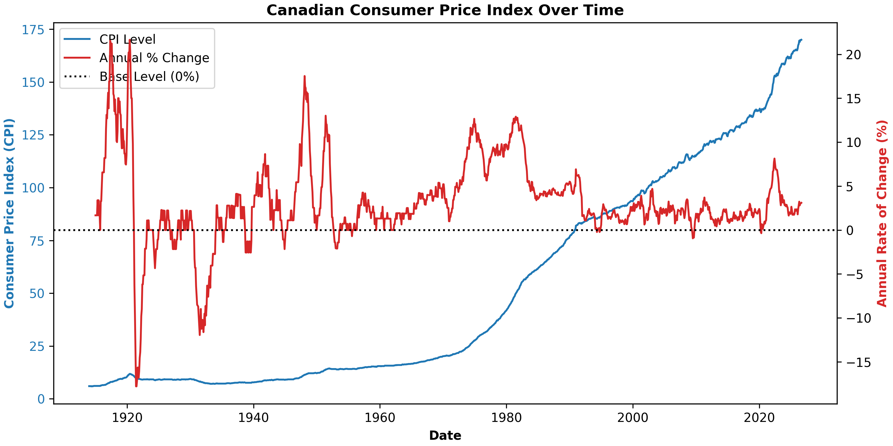

# FINE3300-Canadian-Inflation-Calculator
A Python-based Canadian inflation calculator that reads monthly Consumer Price Index (CPI) data from a file, graphs it, and calculates how the price of goods and services changes between two months using Python, Pandas, Matplotlib, Git, GitHub, and Visual Studio Code.

Function of Each File

1. InflationCalculator.py
This is the main program. It contains the `InflationCalculator` class, which reads the CPI data into a Pandas data frame, calculates the annual percentage change, draws the CPI graph, and interacts with the user. It asks the user for the price of goods or services, the year and month of the first period, and the year and month of the second period. It checks that the price is greater than zero, that the year is between 1914 and 2026, that the month is between 1 and 12, and that the chosen month falls inside the data set. It then calculates and displays the results in the same format as the Bank of Canada inflation calculator.

Example: The user enters $100, January 2006, and January 2026. The program looks up the CPI for both months, then calculates the new price, the percent change, the number of years, and the average annual rate of inflation.

2. STATIC_INFLATIONCALC.csv (Dataset)
This file contains the monthly CPI data from the Bank of Canada (source: Statistics Canada, Consumer Price Index, series V41690973, 2002 = 100), from January 1914 to September 2026. The program reads this file to retrieve the CPI for each month instead of requiring the user to enter it manually.

Example: The dataset gives a CPI of 108.2 for January 2006 and 165.0 for January 2026, and the program uses these values in its calculations.

3. CPI_Inflation_Graph.png
This is the graph created by the program using Matplotlib. It is saved automatically each time the program runs and is shown in the CPI Graph section below.

How to Run
1. Install Python 3 and the required libraries: `pip install pandas matplotlib numpy`
2. Keep `InflationCalculator.py` and `STATIC_INFLATIONCALC.csv` in the same folder.
3. Run `python InflationCalculator.py`.
4. The graph opens first. Close the window to continue to the calculator.
5. Answer the prompts for the price, the first date (year, then month), and the second date (year, then month).

CPI Graph

The blue line (left axis) is the CPI level, the red line (right axis) is the annual percentage change, and the dotted line is the 0% base level.

Commentary
- The CPI rose from about 6 in 1914 to about 170 in 2026, meaning prices are roughly 28 times higher than at the start of the series.
- Inflation was very volatile in the early years, with a spike of well over 10% around 1917-1920 (First World War), followed by a sharp deflation of about -15% in 1921.
- Prices fell again in the early 1930s during the Great Depression, with annual changes near -10%.
- Inflation spiked after the Second World War (late 1940s) and again in the 1970s and early 1980s (oil price shocks), reaching roughly 10-12%.
- Since the early 1990s, annual inflation has stayed mostly near 2%, in line with the Bank of Canada's inflation-control target introduced in 1991.
- The most recent spike is around 2022, when inflation reached about 8% after the COVID-19 pandemic.

Example of Program Execution
Suppose the user wants to know what $100 in January 2006 would cost in January 2026.

Enter the price ($) for the chosen year: 100
Enter the year of the Currently Chosen period (1914-2026): 2006
Enter the month of the Currently Chosen period (1-12): 1
Enter the year of the Desired Prediction period (1914-2026): 2026
Enter the month of the Desired Prediction period (1-12): 1

$100.00 CAD in 1/2006 would cost $152.50 CAD in 1/2026
Percent change: 52.50%
Number of years: 20.00
Average annual rate of inflation: 2.13%
CPI for 1/2006: 108.2
CPI for 1/2026: 165.0

The program multiplies $100 by the CPI ratio (165.0 / 108.2) to produce $152.50, which is a 52.50% increase over 20 years, or about 2.13% per year.